<div align="center">

# 🏠 Domik

**Panel ścienny na tablet z Androidem do sterowników Deimic 1. generacji**

Światła, rolety, ogrzewanie, kalendarz i pogoda na jednym, spokojnym pulpicie –
bez chmury, bez kont, bez zbierania danych. Sterowanie w całości w Twojej sieci domowej.

[**⬇️ Pobierz wersję 0.1.0 (APK)**](https://github.com/milwis/domik/releases/latest) ·
[**📲 Jak zainstalować**](#instalacja-apk) ·
[**📖 Instrukcja konfiguracji tabletu**](android/INSTRUKCJA.md)

</div>

> [!IMPORTANT]
> **Projekt edukacyjny i hobbystyczny – nieoficjalny.** Domik jest niezależnym projektem dla osób, które rozwijają
> swoje zainteresowania smart home na sterownikach Deimic. **Nie jest związany z producentem sterowników Deimic,
> nie jest przez niego wspierany ani zatwierdzony.**
>
> - **To nie jest alternatywa ani zamiennik oficjalnej aplikacji.** Do codziennej, niezawodnej obsługi domu używaj
>   oficjalnej aplikacji producenta oraz przycisków i wyłączników w instalacji.
> - Używasz Domika **na własną odpowiedzialność, bez żadnej gwarancji**.
> - Aplikacja steruje **fizyczną instalacją** (światła, rolety, ogrzewanie). **Nie polegaj na niej w zastosowaniach
>   krytycznych dla bezpieczeństwa** (np. ochrona przed zamarzaniem, pompy) i najpierw wypróbuj ją w **trybie demo**.
> - Łącz ją **wyłącznie z własnym sterownikiem we własnej sieci lokalnej** (albo za zgodą jego właściciela).
>
> Pełne [zastrzeżenia](#zastrzeżenia) – poniżej.

<div align="center">

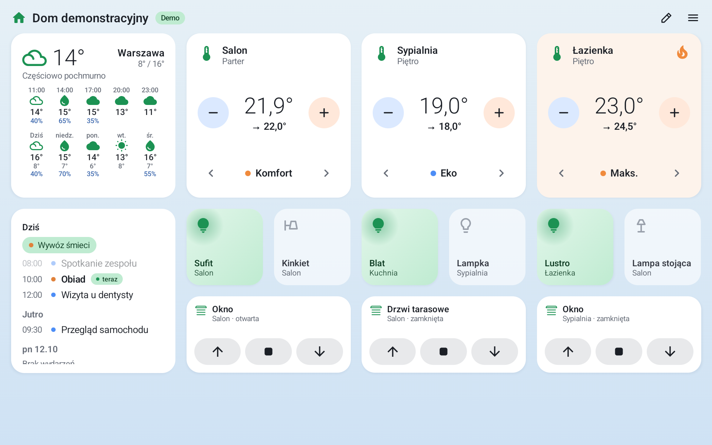

<sub>Tryb demo – fikcyjny dom. W Twoim domu nazwy pomieszczeń, świateł i stref pochodzą z Twojego sterownika.</sub>

</div>

---

## Co potrafi

| | |
|---|---|
| 💡 **Światła i gniazdka** | Cały kafelek jest przełącznikiem – świeci się, gdy światło jest włączone. Stan na żywo, także po użyciu wyłącznika na ścianie. Wyjścia LED i ściemniacze działają jak zwykłe włącz/wyłącz (bez regulacji jasności i koloru). |
| 🔥 **Ogrzewanie** | Każda strefa: temperatura aktualna i zadana, **− / +** co 0,5 °C, zmiana profilu ‹ Wyłączone · Eko · Komfort · Maks. ›, płomyk, gdy strefa grzeje. Stuknięcie kafelka otwiera okno strefy. |
| 🪟 **Rolety** | Kafelek z przyciskami **↑ ■ ↓**. Sterownik 1. generacji nie podaje położenia rolety, więc Domik pokazuje tylko to, co roleta sama zgłosiła: jedzie w górę / w dół, zatrzymana, dojechała do końca. |
| 📅 **Kalendarz** | Prawdziwe wydarzenia z kalendarzy zapisanych na tablecie (np. konto Google dodane w systemie) – tylko odczyt, za Twoją zgodą. Harmonogram dzień po dniu, sam przesuwa się z upływem czasu i podświetla to, co trwa *teraz*. |
| 🌤️ **Pogoda** | Bieżąca pogoda (ikona, temperatura, opis) i prognoza dla miejscowości wybranej w menu: pasek najbliższych godzin (do 48 h) i kolejnych dni (do 14), z szansą opadów. W oknie „Co pokazywać na kafelku” dołożysz temperaturę odczuwalną, wiatr z porywami, wilgotność, indeks UV, wschód i zachód słońca oraz sumę opadów – kafelek pokazuje tyle, ile zmieści jego rozmiar. Dane z [Open-Meteo](https://open-meteo.com), bez konta i bez dostępu do lokalizacji tabletu. |
| ✏️ **Własny układ pulpitu** | Tryb edycji (ikona ołówka): przeciąganie kafelków, dowolny rozmiar (przeciągnięcie rogu), ukrywanie i dodawanie, wybór ikony światła, powrót do układu domyślnego. |
| 🏡 **Twój dom, bez wpisywania** | Pomieszczenia, piętra, światła, rolety i strefy grzewcze Domik pobiera z konfiguracji sterownika – niczego nie trzeba przepisywać. |
| 🖥️ **Tablet ścienny** | Ekran zawsze włączony na ładowarce, pełny ekran bez pasków systemowych, Domik jako ekran główny (start po restarcie tabletu), przypięcie aplikacji. |
| 🎨 **Wygląd** | Motyw jasny, ciemny, systemowy lub **według godzin** (np. ciemny w nocy), 9 kolorów akcentu (na Androidzie 12+ także kolory z tapety). |
| 🧪 **Tryb demo** | Wypróbuj aplikację bez sterownika – symulowany dom z działającymi światłami, roletami i ogrzewaniem. |
| 🔒 **Prywatność** | Ze sterownikiem łączy się tylko w sieci lokalnej (TLS); poza nią wychodzą wyłącznie zapytania o pogodę (Open-Meteo), gdy wyszukujesz lub wybierzesz miejscowość. Numer seryjny zaszyfrowany w sprzętowym magazynie kluczy Androida. Zero telemetrii. |

## Zrzuty ekranu

> Wszystkie zrzuty pochodzą z **trybu demo** (fikcyjny dom „Dom demonstracyjny”, pogoda dla przykładowej miejscowości) – nie przedstawiają prawdziwej instalacji. Powyżej: pulpit w motywie jasnym – po lewej pogoda i kalendarz, w środku strefy ogrzewania, poniżej światła i rolety.

<table>
  <tr>
    <td width="50%">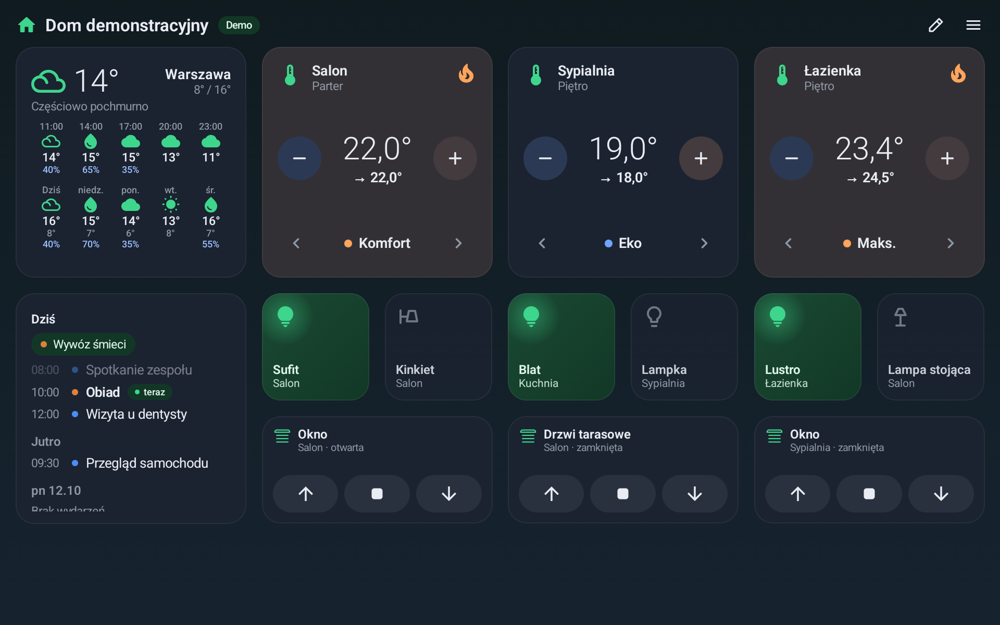<br><sub><b>Pulpit, motyw ciemny</b> – ten sam pulpit na noc, do powieszenia na ścianie. Motyw może przełączać się sam według godzin. Zapalone światła świecą na zielono, a płomyk pokazuje, że strefa grzeje.</sub></td>
    <td width="50%" align="center">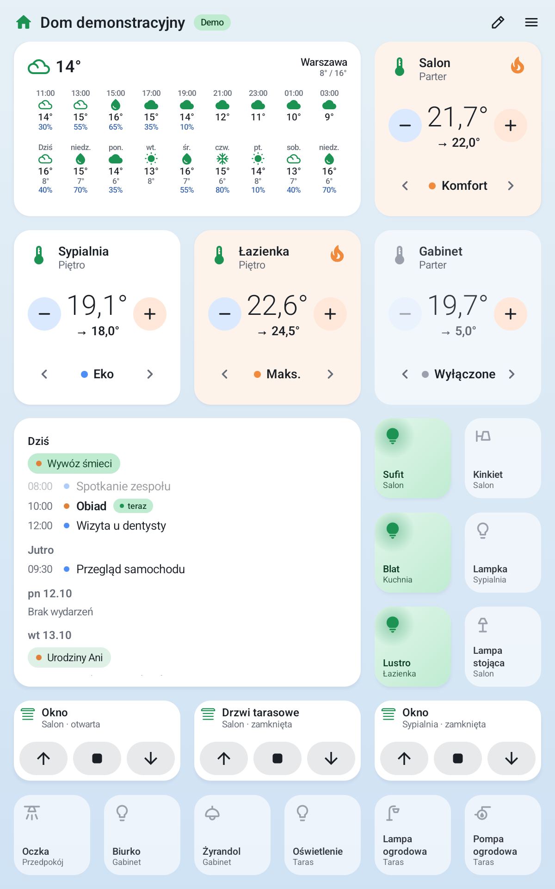<br><sub><b>Tablet w pionie</b> – układ kafelków dopasowuje się do orientacji i rozmiaru ekranu; większy kafelek pogody pokazuje dłuższą prognozę.</sub></td>
  </tr>
  <tr>
    <td>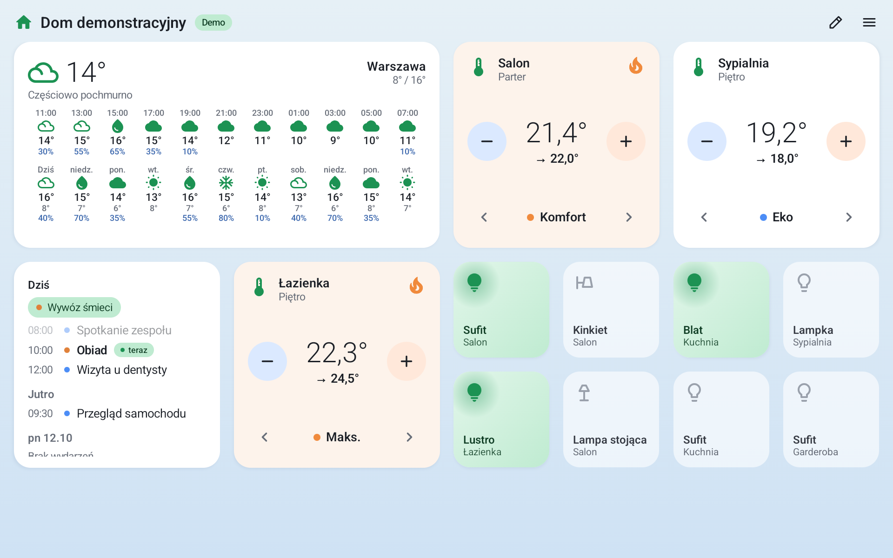<br><sub><b>Pogoda</b> – bieżąca pogoda oraz prognoza godzinowa i dzienna z szansą opadów. Kafelek pokazuje tyle, ile zmieści jego rozmiar (tu 4×2).</sub></td>
    <td>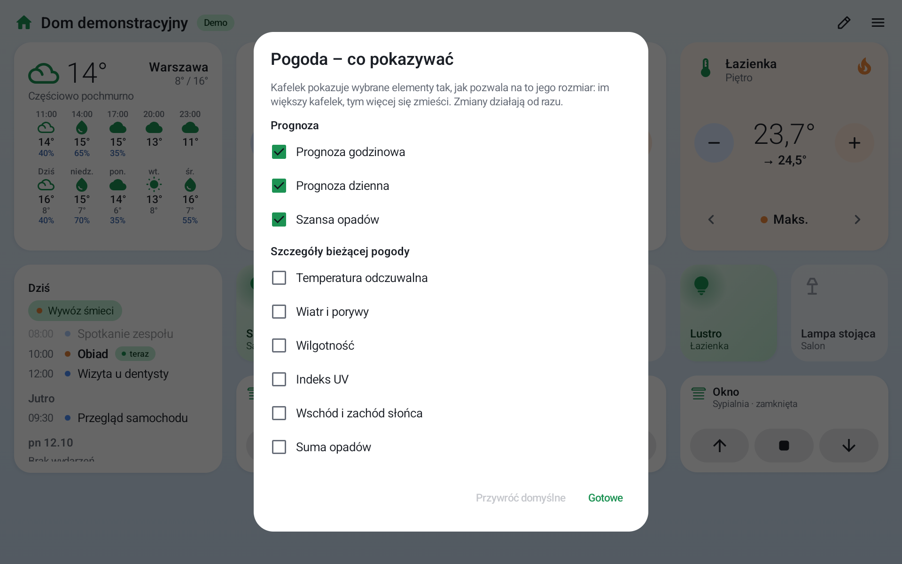<br><sub><b>Pogoda – co pokazywać</b> – wybierasz, które elementy mają się znaleźć na kafelku: temperatura odczuwalna, wiatr, wilgotność, indeks UV, wschód i zachód słońca, suma opadów.</sub></td>
  </tr>
  <tr>
    <td>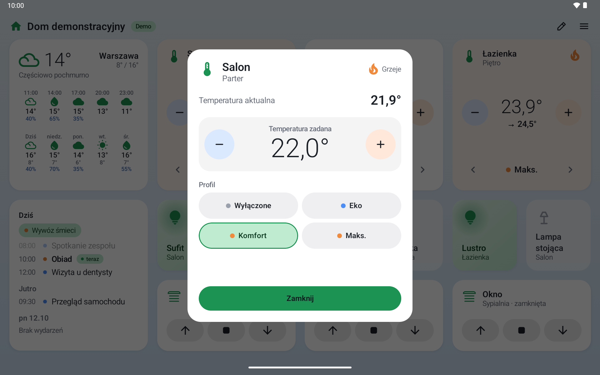<br><sub><b>Strefa ogrzewania</b> – temperatura aktualna i zadana (− / + co 0,5 °C), wybór profilu (Wyłączone, Eko, Komfort, Maks.) i informacja, czy strefa aktualnie grzeje.</sub></td>
    <td>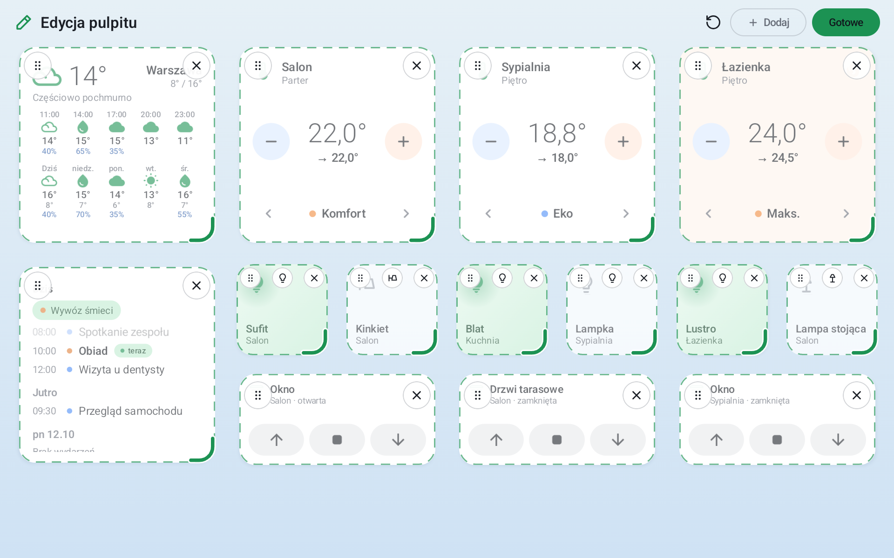<br><sub><b>Edycja pulpitu</b> – kafelki przeciągasz za uchwyt, rozmiar zmieniasz przeciągnięciem rogu, niepotrzebny kafelek ukrywasz, a dla światła wybierasz ikonę.</sub></td>
  </tr>
  <tr>
    <td>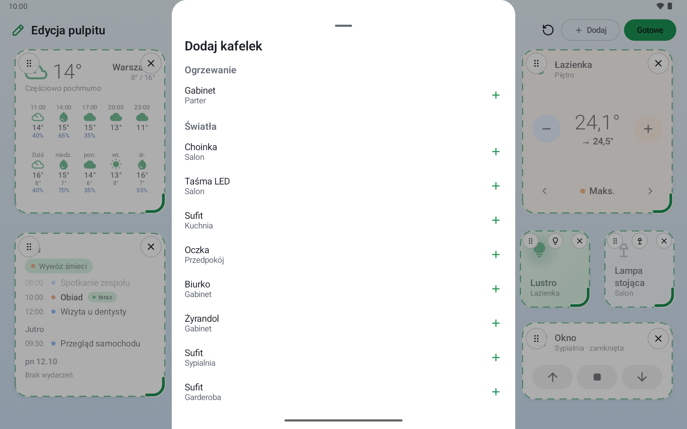<br><sub><b>Dodawanie kafelków</b> – lista ogrzewania, świateł i rolet pobrana z konfiguracji sterownika; ukryty kafelek można tu przywrócić.</sub></td>
    <td>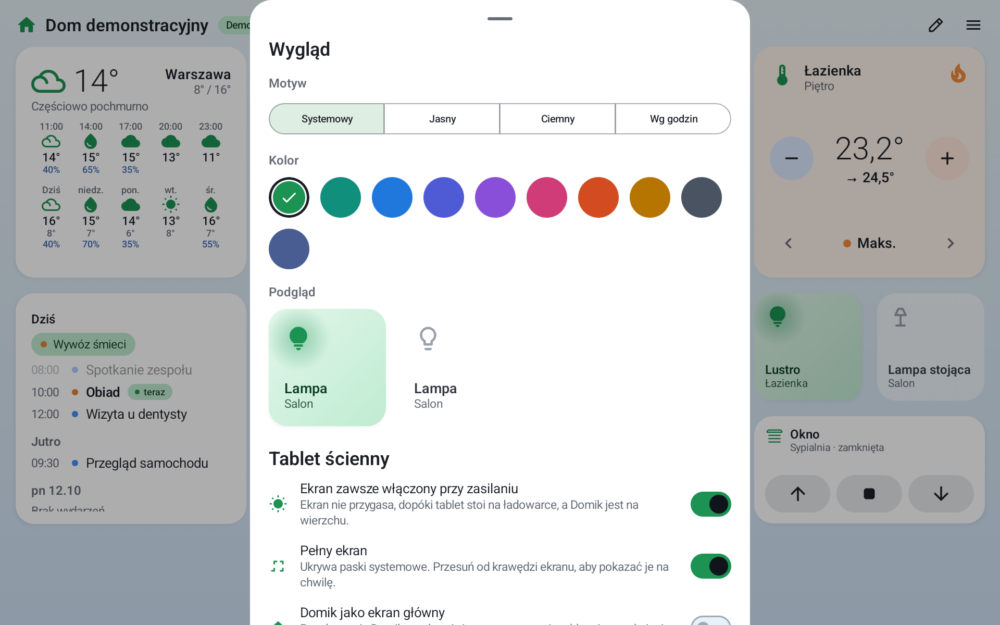<br><sub><b>Wygląd i tablet ścienny</b> – motyw (systemowy, jasny, ciemny, według godzin), kolor akcentu z podglądem oraz ustawienia tabletu na ścianie: ekran zawsze włączony na ładowarce, pełny ekran i Domik jako ekran główny.</sub></td>
  </tr>
  <tr>
    <td>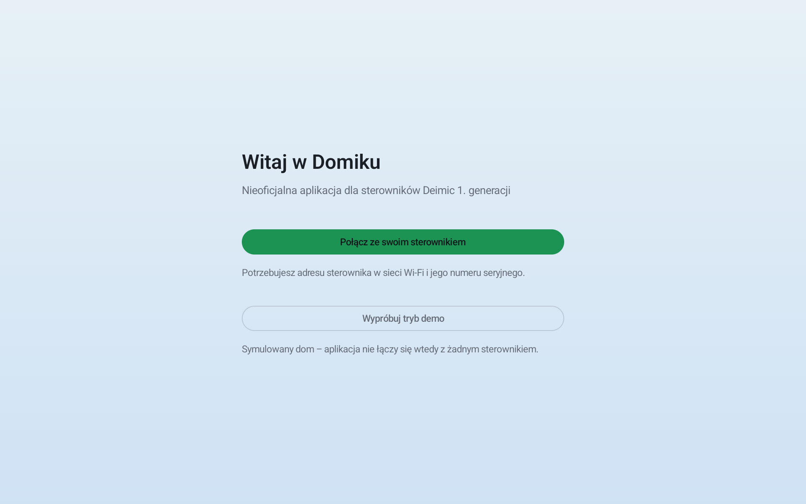<br><sub><b>Pierwsze uruchomienie</b> – do wyboru: połączenie z własnym sterownikiem (potrzebny adres w sieci Wi-Fi i numer seryjny) albo tryb demo bez sterownika.</sub></td>
    <td>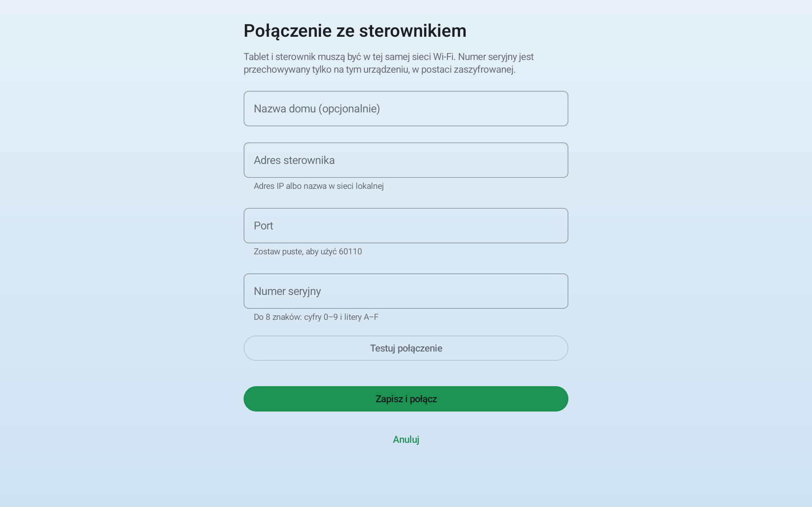<br><sub><b>Połączenie ze sterownikiem</b> – adres, port (domyślnie 60110) i numer seryjny, z przyciskiem „Testuj połączenie” przed zapisaniem.</sub></td>
  </tr>
</table>

## Jak to działa

```
 Tablet z Domikiem  ──── Wi-Fi / LAN, TLS ────►  Sterownik Deimic 1. gen.
   (na ścianie)        tylko sieć lokalna          (port 60110)
        │
        └─────── Internet, HTTPS ─────────────►  Open-Meteo (tylko pogoda:
                 wyszukiwanie i prognoza             nie w trybie demo)
```

- Domik rozmawia bezpośrednio ze sterownikiem jego lokalnym protokołem – bez serwerów pośrednich i bez chmury
  producenta.
- Po połączeniu pobiera konfigurację domu ze sterownika i odświeża ją tylko wtedy, gdy się zmieni.
- Zmiany robione wyłącznikami na ścianie lub w innej aplikacji pojawiają się na pulpicie od razu.
- Jedyny ruch poza Twoją sieć lokalną to pogoda z serwisu [Open-Meteo](https://open-meteo.com) (HTTPS, bez klucza
  i konta), i tylko gdy z niej korzystasz:
  - podczas wyszukiwania miejscowości do serwisu trafia wpisywany tekst (od 2 znaków) i język nazw wyników;
  - po wyborze miejscowości – wyłącznie jej współrzędne zaokrąglone do 2 miejsc po przecinku (ok. 1 km);
    dokładniejsze nie opuszczają tabletu;
  - prognoza odświeża się co 30 minut, gdy Domik jest na ekranie (po powrocie do Domika – gdy jest starsza niż
    15 minut); ostatnia zostaje w pamięci tabletu, żeby po restarcie bez internetu kafelek nie był pusty.

  Bez wybranej miejscowości i w trybie demo (pogoda przykładowa) nic nie jest wysyłane. Domik nie prosi o dostęp do
  lokalizacji (GPS) – miejscowość wskazujesz sam. **Usuń miejscowość** w menu kasuje ją razem z zapisaną prognozą
  i kończy zapytania. Szczegóły – [polityka prywatności](legal/polityka-prywatnosci.md) (§ 4).

## Instalacja (APK)

Domik nie jest w Google Play – instaluje się go z pliku APK, **bez budowania ze źródeł i bez komputera**.
Poniżej krok po kroku (nazwy ustawień różnią się nieco między producentami; opis dotyczy Samsunga z One UI).

1. **Pobierz pliki** ze strony [Releases](https://github.com/milwis/domik/releases/latest):
   **`domik-0.1.0.apk`** oraz (zalecane) **`SHA256SUMS`**. Możesz pobrać je prosto na tablet przeglądarką
   albo na komputer i przenieść na tablet kablem lub dyskiem.
2. **Zezwól na instalację z nieznanych źródeł** dla aplikacji, z której otworzysz plik (przeglądarka albo
   **Moje pliki**): **Ustawienia → Aplikacje → Specjalny dostęp → Instalowanie nieznanych aplikacji** → wybierz
   przeglądarkę / Moje pliki → **Zezwalaj z tego źródła**. Android często sam przeniesie Cię do tego ustawienia,
   gdy stuknięcie pliku zostanie zablokowane.
3. **Stuknij pobrany plik `domik-0.1.0.apk`** i wybierz **Zainstaluj**.
4. **Ostrzeżenie Google Play Protect** (np. „Zablokowano aplikację” / „Nieznany twórca”): stuknij
   **Więcej szczegółów → Zainstaluj mimo to**. Ostrzeżenie pojawia się dlatego, że aplikacji nie ma w Google Play
   i jest podpisana kluczem autora – nie oznacza samo w sobie, że plik jest groźny (patrz niżej, jak sprawdzić
   jego autentyczność).
5. **Cofnij zgodę z kroku 2**, gdy aplikacja jest już zainstalowana (na ścianie nie ma potrzeby jej zostawiać).
6. **Uruchom Domika** – pierwsze uruchomienie i konfigurację tabletu opisuje
   **[instrukcja](android/INSTRUKCJA.md)** (§3 – połączenie ze sterownikiem, §4 – tablet jako panel ścienny).
   Na początek warto wybrać **Wypróbuj tryb demo**.

**Dla zaawansowanych – instalacja kablem (adb):** włącz na tablecie *Opcje programisty* i *Debugowanie USB*,
podłącz tablet do komputera i wykonaj:

```bash
adb install -r domik-0.1.0.apk
```

### Weryfikacja pobranego pliku

Plik APK pobieraj **wyłącznie** ze strony [Releases](https://github.com/milwis/domik/releases/latest) tego repozytorium.
Dobrze jest sprawdzić jego sumę kontrolną – to wystarczy, żeby mieć pewność, że plik nie został zmieniony.

- **macOS / Linux** – w folderze, w którym leżą oba pliki (`domik-0.1.0.apk` i `SHA256SUMS`):

  ```bash
  shasum -a 256 -c SHA256SUMS
  ```

  Wynik powinien brzmieć `domik-0.1.0.apk: OK`.
- **Windows** (PowerShell lub Wiersz polecenia):

  ```bat
  certutil -hashfile domik-0.1.0.apk SHA256
  ```

  Wypisana suma musi być taka sama jak w pliku `SHA256SUMS` i jak niżej.

| | |
|---|---|
| Suma SHA-256 pliku `domik-0.1.0.apk` | `7990fa1924bcbcd54c9245c77e34bc0e2bfb26cbe7e81cf194fff24ca69b4dbd` |
| Odcisk (SHA-256) certyfikatu podpisu aplikacji | `71:0C:AB:67:52:6A:DE:DB:C3:03:3F:44:00:EC:4C:EF:01:E0:C7:A9:C8:0C:2A:B4:54:F8:74:F2:97:9D:C9:59` |

Odcisk certyfikatu podpisu sprawdzisz na komputerze z zainstalowanym Android SDK
(`apksigner verify --print-certs domik-0.1.0.apk`) albo JDK
(`keytool -printcert -jarfile domik-0.1.0.apk`) – wypisane cyfry muszą zgadzać się z tabelą
(wielkość liter i dwukropki nie mają znaczenia).

### Aktualizacje

Wszystkie wydania są podpisane **jednym, stałym kluczem**, więc nową wersję instaluje się **bezpośrednio nad
poprzednią** (tym samym sposobem, co pierwszą) – ustawienia zostają. Wcześniejsze wersje testowe, podpisane kluczem *debug*,
mają inny podpis: trzeba je **raz odinstalować**, a ustawienia wpisać ponownie.

### Wymagania

Android 8.0 lub nowszy (testowane na Samsung Galaxy Tab A11+ z Androidem 16 i na jednym sterowniku autora),
sterownik Deimic 1. generacji („Deimic Master”) w tej samej sieci Wi-Fi/LAN. Do połączenia potrzebujesz
**adresu IP sterownika** i jego **numeru seryjnego** – skąd je wziąć, opisuje
[instrukcja §1](android/INSTRUKCJA.md#1-czego-potrzebujesz). Numer seryjny działa jak klucz do instalacji –
nie udostępniaj go nikomu i nie wklejaj w zgłoszeniach ani na zrzutach ekranu.

## Stan projektu

**0.1.0 – pierwsza działająca wersja testowa.** Sprawdzona tylko na jednym sterowniku i jednym tablecie autora –
u Ciebie (inne oprogramowanie sterownika, inna konfiguracja instalacji, inny tablet) może zachowywać się inaczej.

Gotowe:

- [x] Pulpit na danych ze sterownika: strefy grzewcze (± i profil, okno strefy), przełączniki świateł i gniazdek
- [x] Rolety: kafelek **↑ ■ ↓** (sprawdzony na prawdziwym sterowniku)
- [x] Zdarzenia na żywo (także z wyłączników ściennych), automatyczne ponawianie połączenia
- [x] Prawdziwy kalendarz z tabletu (tylko odczyt, za zgodą)
- [x] Edycja układu pulpitu (przeciąganie, dowolny rozmiar, ukrywanie i dodawanie, wybór ikon, układ domyślny);
  wyjścia alarmowe są domyślnie ukryte, a ich użycie wymaga potwierdzenia
- [x] Tryb tabletu ściennego: ekran włączony przy zasilaniu, pełny ekran, Domik jako ekran główny (start po
  restarcie), przypinanie aplikacji (przypięcie znika po restarcie tabletu – to ograniczenie Androida)
- [x] Pogoda dla wybranej miejscowości (Open-Meteo): bieżąca, godzinowa i na kolejne dni, wybór elementów kafelka,
  układ dopasowany do rozmiaru kafelka, ostatnia prognoza zapamiętana na wypadek braku internetu
- [x] Tryb demo, motywy i palety, ustawienia z zaszyfrowanym numerem seryjnym

W toku i planowane:

- [ ] Auto-wyłączanie (np. garderoba gaśnie po 30 min) – silnik (moduł `automation`) jest napisany i przetestowany,
  ale nie jest jeszcze połączony z aplikacją, więc nie ma ustawień
- [ ] Regulacja jasności i koloru (ściemnianie, RGB) – na razie LED-y i ściemniacze działają tylko jako włącz/wyłącz
- [ ] **Termostaty pokojowe** – dodanie termostatów pokojowych do pulpitu
- [ ] **Wiadomości na żywo (RSS)** – kafelek z nagłówkami z wybranych kanałów RSS, odświeżany na bieżąco
  *(nowe połączenia z zewnętrznymi serwisami – patrz uwaga niżej)*
- [ ] **Wpisy z X (dawniej Twitter)** – najnowsze wpisy obserwowanych twórców, odświeżane na żywo
  (zależy od zasad i dostępności API serwisu X) *(nowe połączenia z zewnętrznymi serwisami – patrz uwaga niżej)*

W dalszej przyszłości (pomysły):

- [ ] **Sterowanie głosem** przez Gemini – w wersji 0.1.0 jeszcze go nie ma
- [ ] **Sterowniki TECH przez eModul** – obsługa także sterowników TECH, przez usługę eModul (wymaga konta
  i połączenia z chmurą tego producenta, w odróżnieniu od obecnej pracy wyłącznie w sieci lokalnej)
  *(nowe połączenia z zewnętrznymi serwisami – patrz uwaga niżej)*

Plany to kierunek rozwoju, a nie obietnica terminu ani zakresu.

> [!NOTE]
> Funkcje, które łączyłyby się z zewnętrznymi serwisami (RSS, X, eModul), oznaczają nowe połączenia poza sieć
> lokalną i przekazywanie danych kolejnym podmiotom. Ich wprowadzenie wymaga zmiany
> [polityki prywatności](legal/polityka-prywatnosci.md) – nowa wersja zostanie opublikowana, a aplikacja poinformuje
> o zmianie przed pierwszym takim połączeniem (polityka prywatności, § 10).

## Zastrzeżenia

Przeczytaj, zanim zainstalujesz.

- **Charakter edukacyjny i hobbystyczny.** Domik powstał jako projekt edukacyjny dla osób rozwijających
  zainteresowania smart home na sterownikach Deimic. **Nie jest alternatywą ani zamiennikiem oficjalnej aplikacji
  producenta** i nie powinien być jedynym sposobem obsługi Twojego domu. Do codziennej, niezawodnej obsługi używaj
  oficjalnej aplikacji i fizycznych wyłączników.
- **Brak związku z producentem.** Projekt jest nieoficjalny, niezależny i nie ma żadnego związku z producentem
  sterowników Deimic – nie jest przez niego tworzony, autoryzowany, sponsorowany, zatwierdzony ani wspierany.
  Producent nie odpowiada za Domika i nie udziela do niego pomocy.
- **Znaki towarowe.** „Deimic”, „Deimic Master” i inne oznaczenia producenta należą do ich właścicieli. Są użyte
  wyłącznie opisowo – żeby wskazać, z jakimi sterownikami Domik jest zgodny. „Android” i „Google Play” są
  znakami towarowymi Google LLC.
- **Niezależna implementacja.** Domik jest napisany od podstaw, niezależnie od oprogramowania producenta. Nie
  zawiera kodu, zasobów ani grafik oficjalnej aplikacji.
- **Tylko sieć lokalna, bez chmury producenta.** Domik rozmawia wyłącznie ze sterownikiem w Twojej sieci lokalnej,
  jego lokalnym protokołem. Nie korzysta z chmury producenta i nie omija jej zabezpieczeń. Nie wgrywa
  oprogramowania do sterownika i nie zmienia konfiguracji instalacji (nazw, wyjść, harmonogramów) – odczytuje ją
  i wysyła polecenia sterujące: włącz/wyłącz, rolety oraz temperaturę zadaną i profil ogrzewania (te dwie ostatnie
  zmieniają ustawienia zapisane w sterowniku – tak jak przy zmianie ich na ścianie lub w innej aplikacji). Warunki
  gwarancji sterownika określa jego gwarant; sprawdź je samodzielnie.
- **Brak zbierania danych.** Autor nie zbiera żadnych danych i aplikacja nie ma telemetrii, analityki, reklam ani kont.
  Adres sterownika, numer seryjny (zaszyfrowany) i ustawienia zostają na Twoim urządzeniu. Jedyne połączenie poza
  Twoją siecią to zapytanie o pogodę do serwisu Open-Meteo, wysyłane dopiero po wskazaniu miejscowości.
- **Brak gwarancji.** Oprogramowanie jest udostępniane „tak jak jest” (*as is*), na licencji MIT, bez jakiejkolwiek
  gwarancji – wyraźnej ani dorozumianej, w tym co do przydatności do określonego celu.
- **Odpowiedzialność.** W granicach dopuszczalnych przez prawo autor nie odpowiada za żadne szkody wynikłe
  z korzystania z Domika lub niemożności korzystania z niego – w tym za niezamierzone zmiany ustawień ogrzewania,
  oświetlenia lub rolet, niewykonane lub opóźnione polecenia, stan na ekranie różniący się od rzeczywistego
  oraz za skutki działania aplikacji na Twoim sterowniku, instalacji i tablecie. Domik nie może być jedynym
  zabezpieczeniem funkcji, od których zależy bezpieczeństwo ludzi, zwierząt lub mienia.
- **Tylko własne urządzenia.** Łącz Domika wyłącznie z własnym sterownikiem – albo cudzym za wyraźną zgodą
  właściciela. **Nie testuj na cudzych urządzeniach i instalacjach.**
- **Prośby podmiotów uprawnionych.** Jeśli jesteś podmiotem praw (np. producentem) i chcesz, żeby coś w tym
  projekcie zmienić lub usunąć, otwórz **Issue** w tym repozytorium – odpowiem możliwie szybko.

## Dla programistów

Kotlin + Jetpack Compose, czysta architektura modułowa:

| Moduł | Zawartość |
|---|---|
| `deimic-protocol` | ramka protokołu V1, dekoder strumieniowy, parsery komunikatów |
| `deimic-client` | połączenie TLS z przypiętym certyfikatem, keepalive, ponawianie, komendy z potwierdzeniem |
| `deimic-config` | pobieranie i odczyt bazy konfiguracji sterownika (własny czytnik SQLite) |
| `automation` | auto-wyłączanie wyjść po czasie (silnik; jeszcze niepodłączony do aplikacji) |
| `demo` | symulowany sterownik dla trybu demo i testów |
| `app` | aplikacja Android: pulpit, kafelki, ustawienia |

```bash
cd android
./gradlew test :app:testDebugUnitTest :app:assembleDebug
```

Szczegóły budowania i podpisywania – [instrukcja §5](android/INSTRUKCJA.md#5-budowanie-ze-źródeł-dla-programistów).
Wektory testowe protokołu: [`testdata/`](testdata/).

Błędy i pomysły zgłaszaj w [Issues](https://github.com/milwis/domik/issues). **Nie wklejaj w zgłoszeniach numeru
seryjnego sterownika, jego adresu IP ani zrzutów ekranu z danymi Twojego domu.**

## Licencja

Domik jest udostępniany na licencji **MIT** – patrz plik [`LICENSE`](LICENSE). Informacje o użytych bibliotekach
(Kotlin, Jetpack Compose, AndroidX – głównie Apache-2.0), znakach towarowych i danych pogodowych znajdziesz
w [`NOTICE.md`](NOTICE.md).

## English summary

**Domik** is an **unofficial, educational/hobby** Android app that turns a tablet into a wall panel for
**1st-generation Deimic controllers** (lights, shutters, heating, calendar, weather). It talks directly to the
controller on your local network – no vendor cloud, no accounts, no telemetry – and has a demo mode that needs no
controller. The only Internet traffic is the optional weather forecast from Open-Meteo (the town search text and the
chosen town's coordinates rounded to 2 decimal places; no device location). All screenshots above come from the demo mode.

> [!IMPORTANT]
> This is an **educational, unofficial** project. It is **not affiliated with, endorsed by or supported by** the
> manufacturer of Deimic controllers, and it is **not an alternative to or a replacement for the official app**.
> “Deimic” and “Deimic Master” are trademarks of their respective owners, used here only to describe compatibility.
> The software is provided **“as is”, without warranty of any kind** (MIT licence); use it **at your own risk**, only
> with your own controller on your own network. It controls physical installations – do not rely on it for
> safety-critical functions, and try the demo mode first. If a rights holder wants something changed or removed,
> please open an Issue.

**Install (3 steps, no building required):**

1. Download `domik-0.1.0.apk` (and `SHA256SUMS`) from [Releases](https://github.com/milwis/domik/releases/latest) and
   verify the checksum (`shasum -a 256 -c SHA256SUMS`; fingerprints are listed in the
   [verification section](#weryfikacja-pobranego-pliku)).
2. On the tablet allow installing unknown apps for your browser / file manager (Settings → Apps → Special access →
   Install unknown apps), tap the APK and, if Play Protect warns, choose *More details → Install anyway*.
3. Open Domik, accept the terms and try the demo mode or enter your controller's IP address and serial number
   (see [`android/INSTRUKCJA.md`](android/INSTRUKCJA.md), in Polish).

Licence: MIT – see [`LICENSE`](LICENSE) and [`NOTICE.md`](NOTICE.md).
